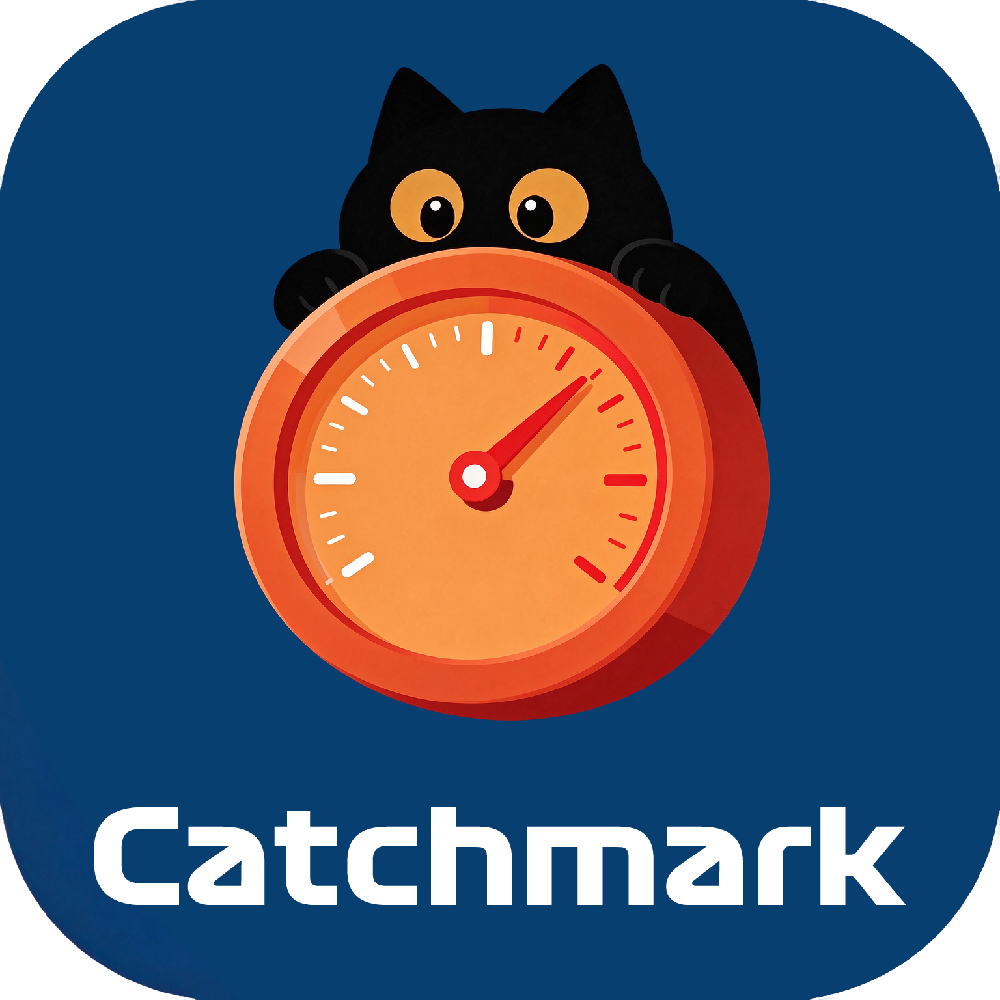

# Catchmark (WN-PBR Benchmark Suite) - A Native Windows Performance Benchmark Tool

<div align="center">



# Catchmark

**WN-PBR 性能基准测试套件**

在 Windows 平台对 CPU、内存、IO 进行多维度基准跑分，输出加密的基准记录，支持结果查看与解密核验。

[](https://github.com/Wing-Smith/Catchmark/releases)
[](https://github.com/Wing-Smith/Catchmark/releases)
[](https://github.com/Wing-Smith/Catchmark)

[下载](https://github.com/Wing-Smith/Catchmark/releases/latest) · [更新日志](https://github.com/Wing-Smith/Catchmark/releases) · [从源码构建](#打包)

</div>

> **📌 Note about the name:**
>
> 这是 WN-PBR Benchmark Suite，专为 Windows 调校的性能跑分工具。
> 不要和其它同名测试工具混淆。本项目使用 Python + Tkinter 开发，Nuitka 编译为原生 EXE。
>
> Catchmark 寓意"捕获性能标记"，记录硬件真实表现。

- GUI：原生 Tkinter，深色主题适配 Windows
- 测试项：大整数运算 / 矩阵运算 / JSON / 素数筛 / 字符串吞吐 / 字典 / 内存带宽 / 列表操作 / IO 吞吐 / GIL 并发
- 纯 Python 3.14（Windows），无重型 GUI 依赖

## 下载

**[最新版 v2.4.0 (Gen2) 已发布 → Releases 页面](https://github.com/Wing-Smith/Catchmark/releases/latest)**

下载 `WN-PBR-Setup-2.4.0.exe` 双击安装即可（Windows 10 1809+，64 位）。

> 跑分数据由本地生成，加密存储为 `.wnpbr` 格式，可在查看器中加载分析。

## 安装（源码环境）

```powershell
py -3.14 -m venv .venv
.venv\Scripts\python.exe -m pip install -i https://pypi.tuna.tsinghua.edu.cn/simple -r requirements.txt
```

## 使用

GUI 主程序：

```powershell
.venv\Scripts\python.exe Program\DDSGG.py
```

### 测试模式说明

- `--classic` 经典三项：大整数 / 矩阵 / JSON
- `--neo` Neo 扩展：经典三项 + 素数筛 / 字符串 / 字典
- `--gen2` Gen2 全量：Neo 六项 + 内存带宽 / 列表操作 / I/O 吞吐 + GIL 并发
- `--custom` 自定义模式：自选测试项目、动态权重

```powershell
# Gen2 全套跑分
.venv\Scripts\python.exe Program\DDSGG.py --gen2

# 自定义测试
.venv\Scripts\python.exe Program\DDSGG.py --custom
```

配套工具：

```powershell
# 结果查看器
.venv\Scripts\python.exe Program\TTESGG.py
# 记录解密器
.venv\Scripts\python.exe Program\SSNGG.py
```

## 打包（PowerShell 7）

```powershell
# 一键 Nuitka 编译脚本
.\Package.ps1
# Inno Setup 安装包编译
# 使用 Inno Setup 7 打开 setup.iss 编译，产物 Release\WN-PBR-Setup-2.4.0.exe
```

## 架构

```
Program/
├─ DDSGG.py      # Benchmark 主引擎入口
├─ TTESGG.py     # 结果查看器
└─ SSNGG.py      # 记录解密工具
Image/            # 图标资源
Assets/           # 安装素材、BMP、PSD
```

- 调度：多线程隔离，GIL 并发专项测试
- 存储：AES 加密 `.wnpbr` 记录文件，防止篡改跑分结果
- 渲染：内置深色 Tkinter UI，低资源占用，适合长时间跑测试

## ❓ FAQ (Frequently Asked Questions)

<details>
<summary><b>1. 关于项目定位 / Project Purpose</b></summary>

**Q: 和 Cinebench、Geekbench 有什么区别？ / What is the difference between Catchmark and Cinebench / Geekbench?**

**A:** Catchmark 偏向 Python 运行时性能基准，专门测试 Python 解释器、内存、IO、GIL 并发表现，适合对比不同 Python 版本、编译参数对脚本性能的影响，不是通用 CPU 工业跑分。 / Catchmark focuses on Python runtime benchmarking. It is designed to test Python interpreter, memory, I/O and GIL concurrency performance. Suitable for comparing Python versions and build parameters, not a general industrial CPU benchmark.

</details>

<details>
<summary><b>2. 技术与架构 / Tech & Architecture</b></summary>

**Q: 为什么选用 Tkinter？ / Why Tkinter?**

**A:** Tkinter 内置在 Python 标准库，无需额外重型 GUI 依赖，打包体积更小、启动更快，非常适合轻量基准工具。 / Tkinter is built into Python standard library. It avoids heavy GUI dependencies, yields smaller package size and faster startup, ideal for lightweight benchmark utilities.

</details>

<details>
<summary><b>3. 平台与生态 / Platforms & Ecosystem</b></summary>

**Q: 支持 Linux / macOS 吗？ / Linux / macOS support?**

**A:** 源码理论可跨平台，但当前打包、安装脚本、加密记录适配仅面向 Windows。本版本优先服务 Windows 用户。 / Source code is theoretically cross-platform, but build scripts, installer and record encryption are tuned for Windows only for this release.

</details>

<details>
<summary><b>4. 报错与故障排查 / Troubleshooting</b></summary>

**Q: Nuitka 编译产物双击闪退 / EXE crashes immediately?**

**A:** 编译时缺少 `--enable-plugin=tk-inter` 参数，或者依赖缺失。使用仓库内 `Package.ps1` 脚本编译，参数已经预设好。 / Missing `--enable-plugin=tk-inter` or dependencies. Use the provided `Package.ps1` build script which contains all required flags.

**Q: Windows Defender 报毒？ / Antivirus false positive?**

**A:** Nuitka 单文件编译特征容易触发杀软误报，你可以本地重新编译源码验证。 / Nuitka single-file binaries are prone to false positives. You can rebuild from source locally for verification.

</details>

<details>
<summary><b>5. 数据与版权 / Data & Copyright</b></summary>

**Q: 跑分记录可以分享吗？ / Can I share benchmark results?**

**A:** `.wnpbr` 文件是加密记录，他人可以用解密器打开核验；项目开源，可自由用于个人测试，禁止篡改跑分用于虚假宣传。 / `.wnpbr` files are encrypted records which can be decrypted for verification. Open source for personal testing, falsified benchmark results are prohibited.

</details>

---

*Last updated: 2026-11*

